# Thrive – Personal Finance Tracker

A modern and responsive Personal Finance Tracker frontend built with React, Vite, Tailwind CSS, and Recharts. The application enables users to manage income, expenses, monthly budgets, and financial reports through an intuitive dashboard.

## Table of Contents

- [1. Introduction](#1-introduction)
- [2. Research](#2-research)
- [3. Tech Stack and Reasons for Choosing](#3-tech-stack-and-reasons-for-choosing)
- [4. Introduction to Libraries](#4-introduction-to-libraries)
- [5. Project Functionality with Screenshots](#5-project-functionality-with-screenshots)
- [6. Conclusion](#6-conclusion)
- [Live Demo](#live-demo)
- [Installation and Setup](#installation-and-setup)
- [Environment Variables](#environment-variables)
- [Project Structure](#project-structure)

---

## 1. Introduction

Thrive is a Personal Finance Tracker designed to help users manage their finances in a simple, organized, and efficient way.

The frontend provides an interactive user interface where users can track their income and expenses, monitor their balance, set monthly budgets, and analyze their financial activity through visual reports.

The application is integrated with the Thrive Backend RESTful API, which handles authentication, transaction management, and budget management.

The frontend is designed with a modern fintech-inspired interface, featuring an emerald-green visual theme, responsive layouts, interactive charts, and clear financial summaries.

### Objectives

- Develop a modern and user-friendly personal finance application.
- Implement user registration and login functionality.
- Create an interactive dashboard for financial overview.
- Allow users to manage income and expenses.
- Provide category-wise transaction filtering and searching.
- Enable users to create and manage monthly budgets.
- Display financial insights through charts and reports.
- Integrate frontend components with backend REST APIs.
- Implement authentication and protected application access.
- Provide a responsive and visually appealing user experience.

---

## 2. Research

### Problem Statement

Managing personal finances manually can be challenging. Users often find it difficult to track their income, expenses, spending patterns, and monthly financial limits.

Traditional manual tracking methods may lack proper visualization and centralized organization, making it harder for users to understand their financial habits.

### Research and Analysis

The requirements of a personal finance management application were analyzed to identify the essential features and user interface components.

The following requirements were identified:

- **User Authentication:** A secure and convenient login and registration interface.
- **Financial Dashboard:** A centralized overview of income, expenses, balance, and savings.
- **Transaction Tracking:** An interface for managing income and expense records.
- **Search and Filtering:** Ability to find transactions using search terms, transaction type, category, and date filters.
- **Budget Management:** A dedicated page for setting and monitoring category-wise monthly budgets.
- **Financial Reports:** Visual representations of financial activity and spending patterns.
- **Responsive Design:** An interface that remains usable across different screen sizes.
- **Backend Integration:** Communication with the backend API for persistent data storage and retrieval.

### Proposed Solution

Thrive provides a centralized financial dashboard and dedicated pages for transactions, budgets, reports, and user profile management.

The frontend uses React components to organize the interface and communicate with the backend APIs. Financial data is dynamically displayed through summary cards, transaction lists, budget progress indicators, and interactive charts.

The solution aims to make personal financial management more accessible, visually understandable, and convenient for everyday use.

---

## 3. Tech Stack and Reasons for Choosing

| Technology | Purpose | Reason for Choosing |
|---|---|---|
| React | Frontend library | Enables component-based development and efficient management of dynamic user interfaces. |
| Vite | Development and build tool | Provides fast development startup, hot module replacement, and optimized production builds. |
| JavaScript | Programming language | Supports interactive frontend logic and API integration. |
| Tailwind CSS | Styling framework | Enables consistent, responsive, and maintainable styling through utility classes. |
| HTML5 | Application structure | Provides the semantic structure of the web application. |
| CSS3 | Styling | Supports layout design, transitions, and visual customization. |
| Recharts | Data visualization | Provides interactive charts for financial insights and spending analysis. |
| Lucide React | Icon library | Provides clean and consistent icons throughout the interface. |
| React Toastify | Notification system | Displays user-friendly success and error notifications. |
| Fetch API | API communication | Enables communication with the backend REST API. |
| Vercel | Frontend deployment | Provides convenient deployment and hosting for the React application. |

---

## 4. Introduction to Libraries

The following libraries and packages were used during frontend development.

| Library / Package | Purpose |
|---|---|
| `react` | Used to build reusable UI components and manage application interfaces. |
| `react-dom` | Used to render React components in the browser. |
| `vite` | Used as the development server and production build tool. |
| `tailwindcss` | Used to style the application with utility-first CSS classes. |
| `@tailwindcss/vite` | Integrates Tailwind CSS with the Vite build process. |
| `recharts` | Used to create interactive financial charts and data visualizations. |
| `lucide-react` | Used to provide icons for navigation, actions, and financial components. |
| `react-toastify` | Used to display success, error, and informational toast notifications. |

### Frontend Architecture

The frontend follows a component-based architecture.

- Reusable components are used to maintain consistent UI elements.
- React state is used to manage dynamic application data.
- React Context is used to manage authentication-related state.
- Fetch API is used to communicate with the backend.
- Environment variables are used to configure the API base URL.
- Conditional rendering is used to display appropriate pages and authentication states.

---

## 5. Project Functionality with Screenshots

Thrive Frontend provides an interactive interface for managing personal finances.

### 5.1 User Authentication

The application provides dedicated Login and Register screens.

#### Login

- Allows registered users to log in using their credentials.
- Communicates with the backend authentication API.
- Handles authentication errors.
- Maintains authenticated application state.
- Provides access to the dashboard after successful login.

#### Register

- Allows new users to create an account.
- Validates user input.
- Provides password visibility controls.
- Displays validation and registration feedback.

**Screenshot: Login Page**

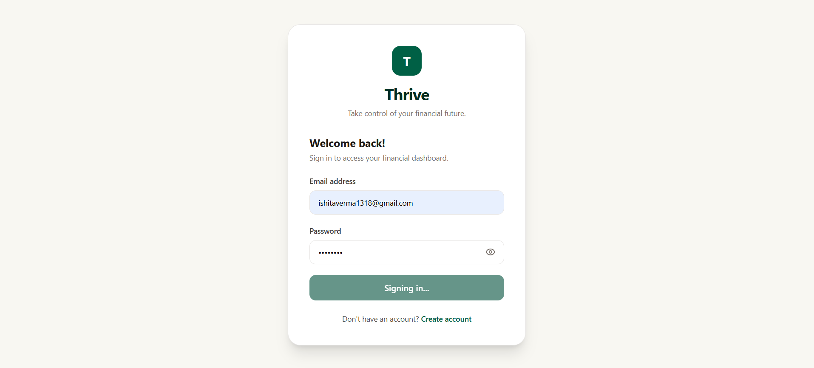

**Screenshot: Register Page**

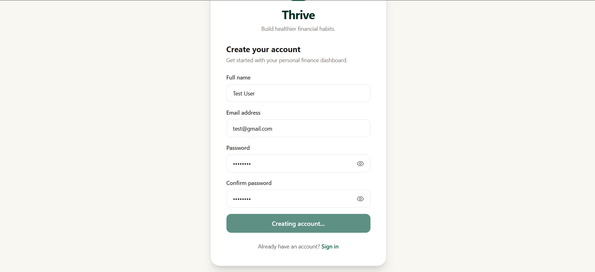

---

### 5.2 Dashboard

The Dashboard provides a centralized overview of the user's financial activity.

#### Financial Summary

The dashboard displays:

- Total Income
- Total Expenses
- Current Balance
- Savings

These values are dynamically calculated using the user's transaction data.

#### Expense Breakdown

A category-wise pie chart displays the distribution of expenses across different categories.

The chart helps users understand where their money is being spent.

#### Monthly Trends

A bar chart displays monthly financial trends and helps users analyze changes in their financial activity over time.

#### Quick Budget Overview

The dashboard also provides a quick overview of budget-related information to help users monitor their spending.

**Screenshot: Dashboard**

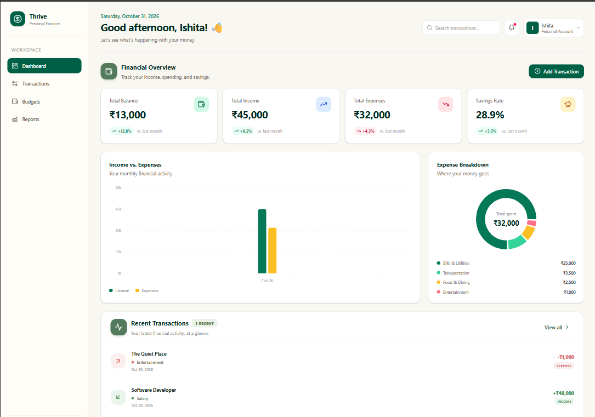

**Screenshot: Expense Breakdown**

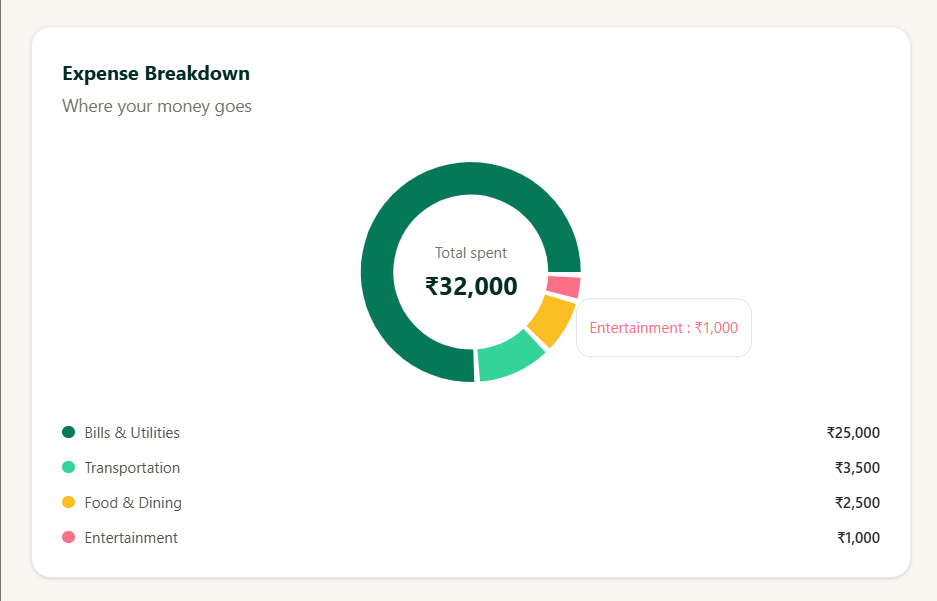

**Screenshot: Monthly Income and Expenses**

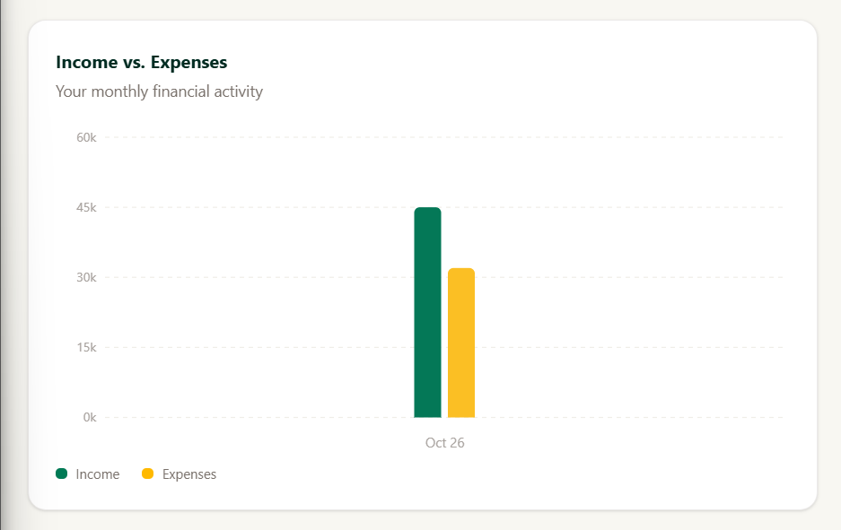

**Screenshot: Dashboard Charts**

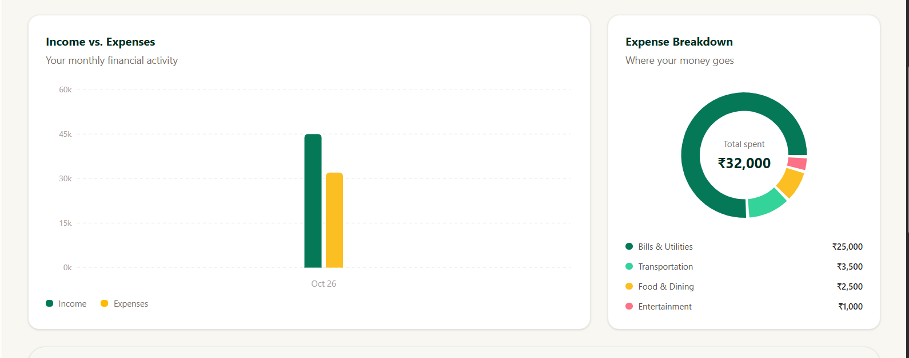

---

### 5.3 Transaction Management

The Transactions section allows users to manage their income and expenses.

#### Features

- Add new income and expense transactions.
- View existing transactions.
- Edit transaction details.
- Delete transactions.
- Search transactions by name or relevant details.
- Filter transactions by category.
- Filter transactions by transaction type.
- Filter transactions by date.
- Display transaction counts based on active filters.
- Update financial summaries after transaction changes.

Each transaction includes details such as name, amount, category, description, date, and transaction type.

**Screenshot: Transaction Management**

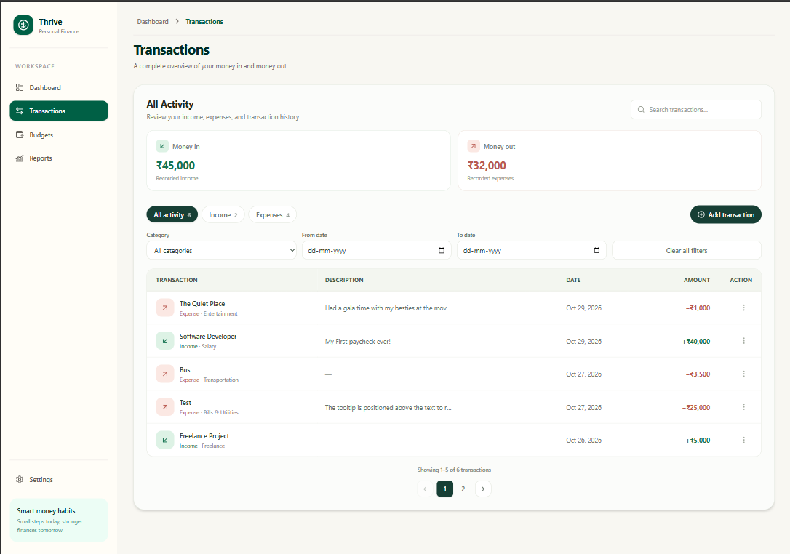

**Screenshot: Transaction List**

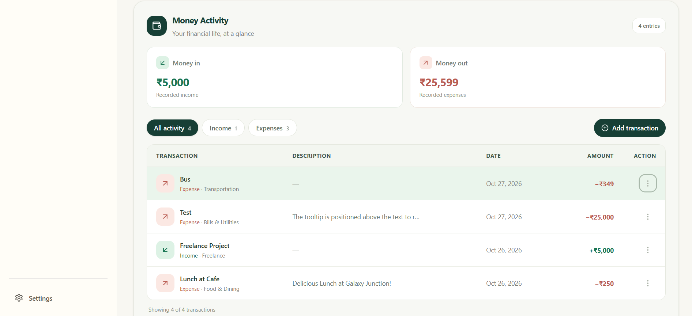

**Screenshot: Add Transaction**

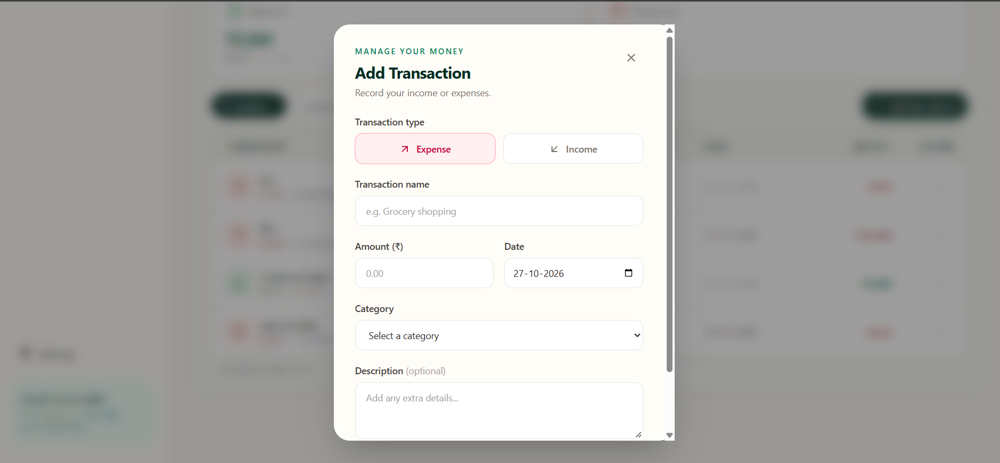

**Screenshot: Delete Transaction**

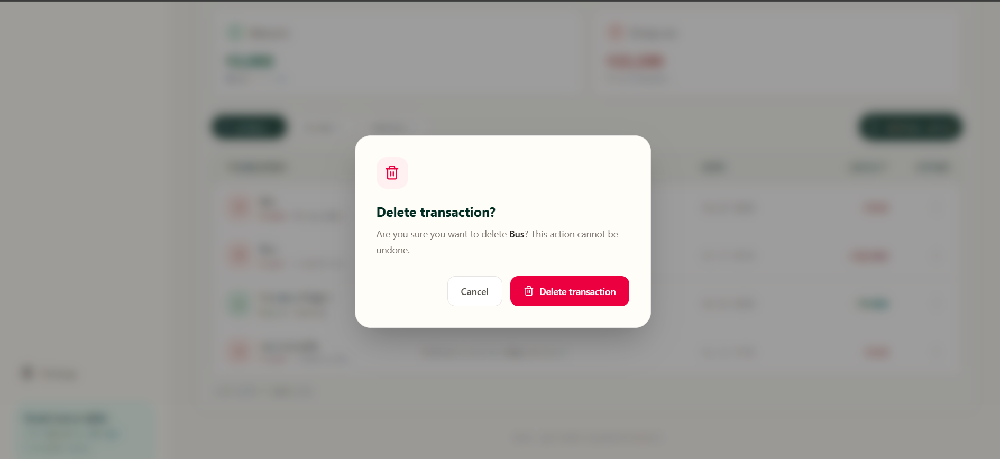

**Screenshot: Transaction Filters**

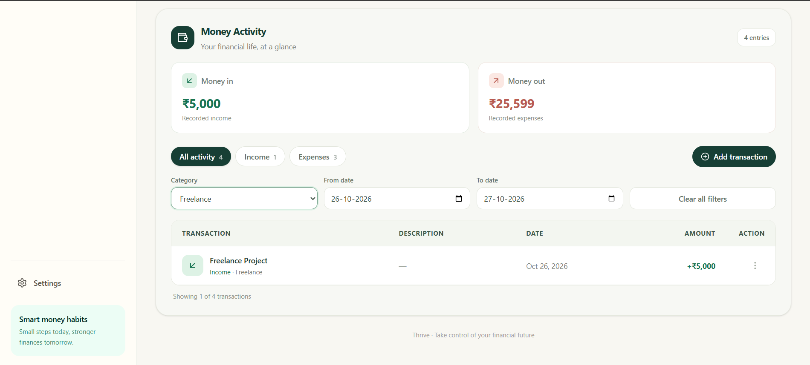

---

### 5.4 Budget Management

The Budgets page enables users to set and monitor monthly spending limits.

#### Features

- Create monthly budgets for expense categories.
- Define a spending limit for each category.
- View the amount spent against the budget.
- Monitor the remaining budget amount.
- Display budget utilization through progress bars.
- Identify when a budget limit has been exceeded.
- Edit existing budgets.
- Delete budgets.
- Retrieve budget information for the selected month and year.

The budget information is dynamically retrieved from the backend and updated when changes are made.

---

### 5.5 Reports

The Reports page provides financial insights through summarized data and visual representations.

#### Features

- Analyze income and expenses.
- View financial summaries.
- Understand category-wise spending.
- Monitor financial trends.
- Visualize financial activity through charts and reports.

The Reports page complements the Dashboard by providing a dedicated area for financial analysis.

---

### 5.6 Profile Management

The Profile page provides an interface for viewing and managing user profile information.

The application also includes a profile dropdown and sign-out functionality.

#### Features

- View profile information.
- Access profile-related functionality.
- Sign out of the application.
- Return to the authentication screen after logout.

---

### 5.7 Frontend and Backend Integration

The Thrive frontend is integrated with the Thrive Backend RESTful API.

The integration includes:

- User registration and login.
- JWT-based authenticated API requests.
- Retrieving financial transactions.
- Creating, updating, and deleting transactions.
- Retrieving monthly budgets.
- Creating, updating, and deleting budgets.
- Displaying backend validation and error messages.
- Updating UI data after successful API operations.

The API base URL is configured through the `VITE_API_URL` environment variable.

---

## 6. Conclusion

The Thrive Frontend successfully provides a modern and interactive interface for a personal finance management application.

Using React, Vite, Tailwind CSS, and Recharts, the application offers a responsive and visually appealing experience for managing income, expenses, budgets, and financial reports.

The frontend is integrated with the Thrive Backend RESTful API, enabling authenticated users to manage their financial data with persistent database storage.

The project provided practical experience in frontend development, component-based architecture, state management, API integration, data visualization, form validation, responsive UI design, and deployment.

Thrive can be further enhanced with additional features such as recurring transactions, financial goal tracking, advanced analytics, and notification systems.

---

## Live Demo

- **Frontend Application:** [Thrive Finance Tracker](https://thrive-finance-tracker.vercel.app/)
- **Backend API:** [Thrive Backend](https://thrive-backend-zcug.onrender.com/)
- **Frontend Repository:** Add your frontend GitHub repository URL.
- **Backend Repository:** [Finance-Tracker-Backend](https://github.com/ishitaverma-cse/Finance-Tracker-Backend)

---

## Installation and Setup

Follow these steps to run the frontend locally.

### Prerequisites

Ensure that the following are installed:

- Node.js
- npm
- Git
- A running Thrive Backend API

### Step 1: Clone the Repository

```bash
git clone <your-frontend-repository-url>
```

### Step 2: Navigate to the Project Directory

```bash
cd <your-frontend-project-directory>
```

### Step 3: Install Dependencies

```bash
npm install
```

### Step 4: Configure Environment Variables

Create a `.env` file in the root directory.

Refer to the Environment Variables section below.

### Step 5: Start the Development Server

```bash
npm run dev
```

The frontend development server will run at:

```text
http://localhost:5173
```

### Step 6: Build for Production

To create an optimized production build:

```bash
npm run build
```

To preview the production build locally:

```bash
npm run preview
```

---

## Environment Variables

Create a `.env` file in the root directory.

```env
VITE_API_URL=http://localhost:5000/api
```

| Variable | Description |
|---|---|
| `VITE_API_URL` | Base URL of the Thrive Backend RESTful API. |

### Production Configuration

For production deployment on Vercel, configure the following environment variable:

```env
VITE_API_URL=https://thrive-backend-zcug.onrender.com/api
```

**Important:** Environment variables prefixed with `VITE_` are exposed to the frontend browser bundle. Do not store passwords, private API keys, database credentials, or JWT secrets in frontend environment variables.

---

## Project Structure

```text
Finance-Tracker-Frontend/
│
├── docs/
│   ├── day-1/
│   ├── day-3/
│   ├── day-6/
│   ├── day-7/
│   ├── day-8/
│   └── day-11/
│
├── src/
│   ├── components/
│   │   ├── TransactionsPage.jsx
│   │   ├── BudgetsPage.jsx
│   │   ├── ReportsPage.jsx
│   │   └── ...
│   │
│   ├── context/
│   │   └── AuthContext.jsx
│   │
│   ├── App.jsx
│   ├── main.jsx
│   └── ...
│
├── public/
│
├── .env
├── .gitignore
├── package.json
├── package-lock.json
├── vite.config.js
└── index.html
```

---

**Developed as part of the Thrive Personal Finance Tracker project.**
